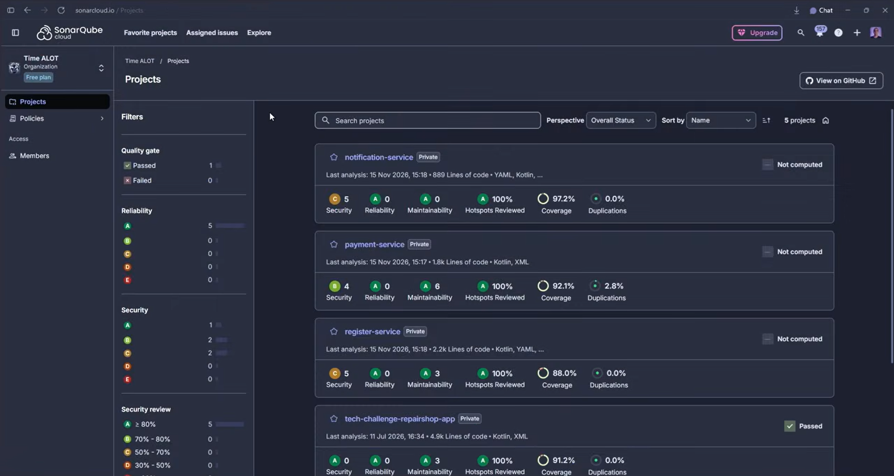
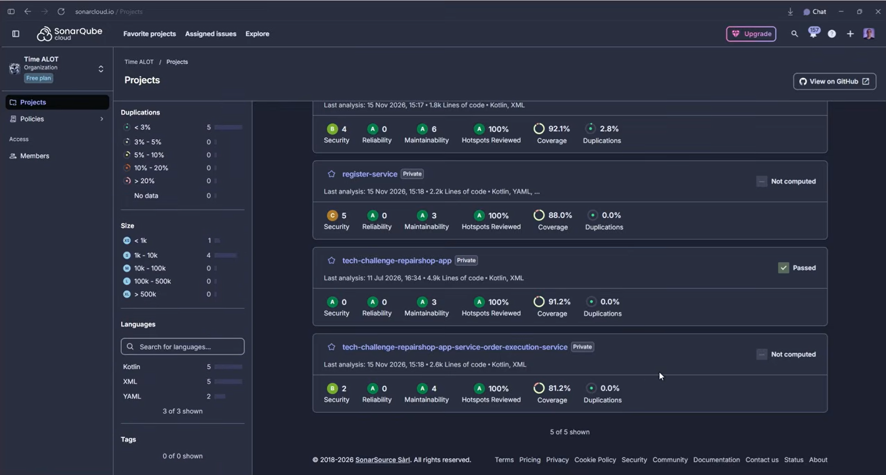

# ⚙️📋 Repair Shop — Service Order Execution Service (`app-service-order-execution-service`)

[](https://github.com/tech-challenge-fiap-repairshop/tech-challenge-repairshop-app-service-order-execution-service/actions/workflows/ci.yml)
[](https://openjdk.org/)
[](https://kotlinlang.org/)
[](https://spring.io/projects/spring-boot)

Microsserviço central de **Execução e Orquestração de Ordens de Serviço (OS)** da plataforma **Repair Shop (Tech Challenge FIAP — 15SOAT)**. Gerencia o ciclo completo de **12 estados da Ordem de Serviço**, execuções técnicas, aprovação de tarefas extras, persistência transacional em **Amazon DynamoDB (Single-Table Design)**, orquestração assíncrona via **Amazon SQS** e emissão de métricas customizadas de negócio.

---

## 📋 Índice

- [Domínio, Estados da OS e Endpoints](#domínio-estados-da-os-e-endpoints)
- [Arquitetura Atual — Motivação e Benefícios dos Componentes](#arquitetura-atual--motivação-e-benefícios-dos-componentes)
- [Por que DynamoDB em vez de Banco Relacional neste Microsserviço?](#por-que-dynamodb-em-vez-de-banco-relacional-neste-microsserviço)
- [Single-Table Design e Fluxo SQS (Saga Coreografada)](#single-table-design-e-fluxo-sqs-saga-coreografada)
- [Como Executar Localmente](#como-executar-localmente)
- [Como Executar em Produção (Esteira CI/CD GitHub Actions)](#como-executar-em-produção-esteira-cicd-github-actions)
- [Documentação Técnica e Collection do Postman](#documentação-técnica-e-collection-do-postman)

---

## Domínio, Estados da OS e Endpoints

O serviço escuta na porta **`8080`** e implementa a máquina de estados completa (`ServiceOrderStatus`) com **12 estados**:

`RECEIVED` -> `IN_DIAGNOSIS` -> `WAITING_APPROVAL` -> `APPROVED` / `REFUSED` -> `IN_EXECUTION` -> *(opcional: `WAITING_APPROVAL_EXTRA_TASKS` -> `APPROVAL_EXTRA_TASKS` / `REFUSED_EXTRA_TASKS`)* -> `FINALIZED` -> `PAID` *(ou `CANCELED`)*.

| Controller | Rotas Principais | Descrição |
| :--- | :--- | :--- |
| **`ServiceOrderController`** | `POST /service-orders`, `GET /service-orders`, `GET /service-orders/{id}`, `GET /service-orders/customers/{customerId}`, `GET /service-orders/vehicles/{vehicleId}`, `PATCH /service-orders/{id}/status`, `DELETE /service-orders/{id}` | Abertura, consulta e transição controlada de status da Ordem de Serviço (inclui disparo de notificação de orçamento via SQS quando entra em aprovação). |
| **`ExecutionController`** | `POST /service-orders/{serviceOrderId}/executions`, `GET /service-orders/{serviceOrderId}/executions`, `PATCH /service-orders/{serviceOrderId}/executions/{executionId}` | Registro e controle da execução principal das tarefas da OS. |
| **`TaskExecutionController`** | `POST /execute_task/{executionId}`<br>`POST /increment_execution_task/{serviceOrderId}` | Avanço das tarefas em execução e solicitação de tarefas extras com fluxo de aprovação. |

- **Swagger / OpenAPI**: `/swagger-ui.html` (autenticação `Bearer Authentication` JWT)
- **Actuator Health Probes**: `/actuator/health/readiness` (`readinessState`) e `/actuator/health/liveness` (`livenessState,sqsListener`, monitorando idle timeout máximo de `120s` por fila em `SqsListenerHealthIndicator`)
- **Métricas de Negócio**: `BusinessMetricsBinder` exporta métricas operacionais de OS via Micrometer/Prometheus.

---

## Arquitetura Atual — Motivação e Benefícios dos Componentes

| Pilar / Tecnologia | Papel no Ecossistema | Motivação Técnica e Pontos Positivos |
| :--- | :--- | :--- |
| **RDS (PostgreSQL 16)** | Persistência relacional do irmão [`app-register-service`](https://github.com/tech-challenge-fiap-repairshop/tech-challenge-repairshop-app-register-service) via [`infra-db-rds`](https://github.com/tech-challenge-fiap-repairshop/tech-challenge-repairshop-infra-db-rds) | Mantido onde integridade referencial rígida (`tb_customer`, `tb_vehicle`, `tb_user`), constraints `UNIQUE` e consultas SQL cadastrais agregam valor direto com baixo risco de contenção. |
| **DynamoDB (NoSQL)** | **Banco principal deste microsserviço** (`tb-service_order-{env}` via [`infra-db-dynamo`](https://github.com/tech-challenge-fiap-repairshop/tech-challenge-repairshop-infra-db-dynamo)) | Single-Table Design com `TransactWriteItems` e GSI `pending-dispatch-index`. Oferece alta taxa de escrita/leitura, escalabilidade automática `PAY_PER_REQUEST`, PITR habilitado e ausência de gargalos de conexão em Kubernetes com HPA. |
| **ElastiCache (Redis 7.0)** | Provisionado via [`infra-redis`](https://github.com/tech-challenge-fiap-repairshop/tech-challenge-repairshop-infra-redis) para o contexto de login/cadastro | Camada em memória (`cache.t3.micro` / `cache.t3.small`) configurada no `register-service` para viabilizar sessões e tokens JWT de baixíssima latência sem impactar este serviço de execução. |
| **Apps (EKS + Lambda Auth)** | Container no **EKS (`1.31`)** ([`infra-eks`](https://github.com/tech-challenge-fiap-repairshop/tech-challenge-repairshop-infra-eks)) | Execução distribuída com HPA, Graceful Shutdown e isolamento de domínio em Clean Architecture; recebe tráfego autenticado após emissão do token via [`lambda-auth`](https://github.com/tech-challenge-fiap-repairshop/tech-challenge-repairshop-lambda-auth). |
| **Amazon SQS (Mensageria + DLQ)** | **Eixo central de coreografia deste serviço** ([`infra-sqs`](https://github.com/tech-challenge-fiap-repairshop/tech-challenge-repairshop-infra-sqs)) | Publica solicitações de aprovação e avisos de OS pronta para pagamento (`schedulerOsReadyForPayment`) e consome callbacks de aprovação e confirmações de pagamento com suporte a DLQs (14 dias de retenção) e propagação de `traceparent`. |
| **API Gateway (HTTP API v2)** | Ponto único de entrada ([`infra-apigateway`](https://github.com/tech-challenge-fiap-repairshop/tech-challenge-repairshop-infra-apigateway)) | Roteia `/service-orders/**`, `POST /execute_task/{proxy+}` e `POST /increment_execution_task/{proxy+}` diretamente para o NLB interno deste serviço no EKS, ocultando a VPC privada e padronizando CORS com headers OpenTelemetry. |
| **Observabilidade (Grafana)** | Dashboards dedicados `service-order-execution-observability` e `logs-traces`, além do `business-metrics` | Agente OpenTelemetry envia traces e métricas para OTel Collector -> Prometheus + Jaeger + Loki. A propagação manual do header W3C `traceparent` nos `MessageAttributes` do SQS conecta o trace desde a abertura da OS até o pagamento e envio do e-mail. |

---

## Por que DynamoDB em vez de Banco Relacional neste Microsserviço?

A adoção do **Amazon DynamoDB** em `tb-service_order-{env}` em vez de PostgreSQL/RDS neste contexto é fundamentada em quatro fatores arquiteturais concretos:

1. **Padrão de acesso orientado ao agregado da OS (`Single-Table Design`)**: Cada Ordem de Serviço reúne múltiplos sub-registros heterogêneos sob a mesma `PK = ORDER#<id>` diferenciados pela Sort Key (`METADATA`, `HIST#<timestamp>`, `EXEC#<execId>`, `EXTRA_EXEC#<execId>`). Em um banco relacional, montar a visão consolidada da OS exigiria múltiplos `JOIN`s entre tabelas normalizadas; no DynamoDB, uma única `Query` por `PK` recupera todo o histórico e execuções em milissegundos constantes.
2. **Atomicidade transacional sem locks distribuídos**: Com `TransactWriteItems` (`DynamoServiceOrderRepository`), o serviço atualiza o estado principal (`METADATA`) e grava simultaneamente o registro imutável de histórico (`HIST#*`) ou execução em operação atômica, evitando inconsistências e bloqueios de linha/tabela durante callbacks concorrentes.
3. **Resiliência a auto-scaling (HPA) e múltiplos workers SQS/agendadores**: Pods que escalam rapidamente no EKS não esgotam pool de conexões JDBC (como ocorreria em uma instância RDS `db.t3.micro`), pois toda comunicação com o DynamoDB ocorre via HTTPS *stateless* com capacidade elástica (`PAY_PER_REQUEST`).
4. **Varredura eficiente de despacho para pagamento via GSI (`pending-dispatch-index`)**: O agendador `schedulerOsReadyForPayment` consulta o índice secundário global por `payment_dispatch_status` + `update_date` para enfileirar OS finalizadas no SQS sem jamais executar `Scan` completo na tabela de produção.

---

## Single-Table Design e Fluxo SQS (Saga Coreografada)

| Direção | Fila SQS (`-{env}`) | Papel na Coreografia |
| :--- | :--- | :--- |
| **Producer** | `approve-notification-queue-dev` | Envia OS aguardando aprovação de orçamento ou tarefas extras para o `notification-service`. |
| **Consumer** | `callback-approve-notification-queue-dev` | Recebe aprovação ou recusa do cliente vinda do `notification-service` e avança o status da OS. |
| **Producer** | `os-ready-for-payment-queue-dev` | Publicada pelo agendador (`schedulerOsReadyForPayment`, intervalo configurável em `scheduler.os-payment.delay`, padrão `1800000 ms` / 30 min) quando a OS é finalizada. |
| **Consumer** | `payment-success-queue-dev` | Consome confirmação de liquidação vinda do `payment-service` e transiciona a OS para **`PAID`**. |

> **Observabilidade na Mensageria**: O `ServiceOrderSqsMessenger` injeta `traceparent` nos atributos das mensagens enviadas e restaura o contexto pai ao consumir callbacks e confirmações de pagamento, mantendo o **trace end-to-end intacto no Jaeger**.

> **Nota sobre build Maven**: Este repositório **não inclui Maven Wrapper** (`mvnw`). Utilize `mvn` instalado localmente com **JDK 24**.

---

## Como Executar Localmente

### Pré-requisitos
- **Docker** e **Docker Compose**
- **JDK 24** e **Apache Maven 3.9+** (`mvn`)

### Passo a Passo com Docker Compose + LocalStack (Recomendado)

O arquivo [`docker-compose.yml`](docker-compose.yml) sobe o **LocalStack** (emulando **DynamoDB** e **SQS** na porta `4566`) junto com o microsserviço na porta `8080`:

```bash
# Subir LocalStack (DynamoDB + SQS) e o Service Order Execution Service
docker compose up -d --build

# Acompanhar os logs
docker compose logs -f service-order-execution-service
```

*(Caso utilize apenas o LocalStack no Compose e rode a aplicação pela IDE/Maven, crie previamente a tabela `tb-service_order-dev` e as 4 filas no endpoint `http://localhost:4566`.)*

- **Swagger UI**: `http://localhost:8080/swagger-ui.html`
- **Healthcheck**: `http://localhost:8080/actuator/health`

Para rodar os testes unitários, BDD e relatório de cobertura:
```bash
mvn clean verify
```

Para encerrar o ambiente local:
```bash
docker compose down -v
```

> *Observação: A pasta [`local/`](local/kustomization.yaml) mantém referências legadas de manifestos Kustomize da fase anterior; para desenvolvimento local do microsserviço já migrado para DynamoDB + SQS, utilize o `docker-compose.yml` na raiz do repositório.*

---

## Como Executar em Produção (Esteira CI/CD GitHub Actions)

O deploy é automatizado em [`.github/workflows/ci.yml`](.github/workflows/ci.yml) (e remoção controlada via [`.github/workflows/destroy.yml`](.github/workflows/destroy.yml)).

### Etapas da Pipeline (`ci.yml`)
1. **`build`**: Compila com JDK 24 (`mvn clean package -DskipTests`) e executa smoke test real do JAR (`target/repairshop-0.0.1-SNAPSHOT.jar`) validando `/actuator/health` na porta `8080`.
2. **`test`**: Executa `mvn clean verify` publicando relatórios **JaCoCo** e **Cucumber**.
3. **`quality`**: Roda scanner **Trivy FS (SCA)** diretamente no `pom.xml` (`exit-code: '1'` para vulnerabilidades `CRITICAL`/`HIGH`) e envia análise ao **SonarCloud**.
4. **`docker-build-push`**: Constrói a imagem para o **Amazon ECR** (`service-order-execution-service-{env}`), valida novamente a imagem com Trivy e testa subida do container.
5. **`deploy`**:
   - Atualiza `kubeconfig` no cluster `repairshop-eks-{env}`.
   - Aplica [`k8s/namespace.yaml`](k8s/namespace.yaml), os `ConfigMap`s de observabilidade em [`k8s/configs/`](k8s/configs/), [`k8s/deployment.yaml`](k8s/deployment.yaml), [`k8s/service.yaml`](k8s/service.yaml), [`k8s/hpa.yaml`](k8s/hpa.yaml) e manifestos da stack de observabilidade (`otel-collector`, `prometheus`, `jaeger`, `loki`, `grafana`, `mailpit`), validando o `rollout status`.

---

## Cobertura de testes (SonarQube)




---

## Documentação Técnica e Collection do Postman

Este repositório também hospeda o pacote completo de arquitetura, observabilidade e testes de carga da organização:

- **Postman Collections & Environment**:
  - Collection Principal: [`Repair Shop (Tech Challenge FIAP)`](docs/postman/Repair%20Shop%20%28Tech%20Challenge%20FIAP%29.postman_collection.json)
  - Collection Completa: [`Tech Challenge FIAP - Completo`](docs/postman/Tech_Challenge_Fiap_-_Completo.postman_collection.json)
  - Environment Local: [`Local.postman_environment.json`](docs/postman/Local.postman_environment.json)
  - Guia do Postman: [`docs/postman/README.md`](docs/postman/README.md)
- **Dashboards Grafana (11 arquivos JSON completos)**: [`local/observability/grafana/dashboards/`](local/observability/grafana/dashboards/) — inclui [`service-order-execution-observability`](local/observability/grafana/dashboards/repairshop-service-order-execution-observability.json), [`service-order-execution-logs-traces`](local/observability/grafana/dashboards/repairshop-service-order-execution-logs-traces.json) e [`business-metrics`](local/observability/grafana/dashboards/repairshop-business-metrics.json)
- **Decisões Arquiteturais e RFCs**:
  - [ADRs (`ADR-001` a `ADR-013`)](ADRs/README.md)
  - [RFCs (`RFC-001` a `RFC-014`)](RFCs/README.md)
- **Modelagem DDD, Infra e Sequência**:
  - [`Dicionário de Linguagem Ubíqua`](docs/delivery/domain_driven_design/dicionario-linguagem-ubiqua.md)
  - [`Diagrama de Arquitetura`](docs/delivery/clean_arquiteture/diagrama_arquitetura.png) | [`Entidades e Contextos`](docs/delivery/clean_arquiteture/diagrama_entidades_e_contextos.png)
  - [`Diagrama de Infraestrutura Cloud`](docs/delivery/infrastructure/repairshop-diagrama-infra-cloud.svg) | [`Máquina de Estados`](docs/delivery/infrastructure/status_chain.png)
  - [`Diagrama de Sequência — Auth e Abertura de OS`](docs/delivery/sequence/diagrama_sequencia_auth_abertura_os.drawio.png)
- **Qualidade, Segurança e Carga**:
  - [`OWASP ZAP Report`](docs/delivery/owaspzap/2026-05-01-ZAP-Report-.html) | [`Locust HPA Stress Test`](docs/delivery/hpa_stress/locustfile.py) | [`SonarQube Analysis`](docs/delivery/sonar/sonarqube_cloud_analysis.pdf)
- **Repositórios relacionados**: [`infra-db-dynamo`](https://github.com/tech-challenge-fiap-repairshop/tech-challenge-repairshop-infra-db-dynamo) | [`infra-sqs`](https://github.com/tech-challenge-fiap-repairshop/tech-challenge-repairshop-infra-sqs) | [`infra-apigateway`](https://github.com/tech-challenge-fiap-repairshop/tech-challenge-repairshop-infra-apigateway)
