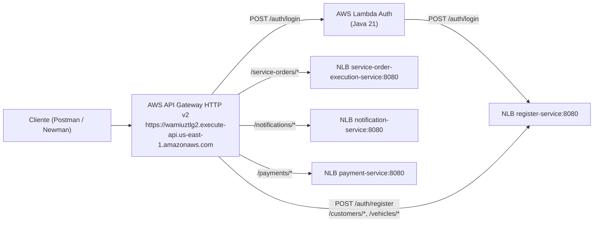

# 📮 Coleção Postman & Automação de Testes — RepairShop (Fase 4)

Este diretório contém a coleção oficial do **Postman** e os ambientes configurados para validação ponta a ponta dos 4 microsserviços e da função Serverless AWS Lambda Auth do ecossistema **RepairShop**, orquestrados através do **AWS API Gateway HTTP v2** ou em ambiente local.

---

## 📁 Artefatos Disponíveis

| Arquivo | Descrição |
| :--- | :--- |
| [`Tech_Challenge_Fiap_-_Fase_4.postman_collection.json`](Tech_Challenge_Fiap_-_Fase_4.postman_collection.json) | Coleção completa cobrindo os 28 passos cronológicos da Saga de atendimento da oficina |
| [`AWS_APIGateway_Prd.postman_environment.json`](AWS_APIGateway_Prd.postman_environment.json) | Ambiente configurado com o endpoint ao vivo do API Gateway (`https://wamiuztlg2.execute-api.us-east-1.amazonaws.com`) |
| [`Local_Microservices.postman_environment.json`](Local_Microservices.postman_environment.json) | Ambiente para execução local apontando para as portas dos microsserviços e gateway local (`:8080`) |

---

## 🌐 Roteamento e Caminhos Relativos por Serviço

O **AWS API Gateway HTTP v2** atua como Ponto Único de Entrada (`baseUrl`), roteando de forma transparente para cada microsserviço no cluster AWS EKS através de Network Load Balancers internos e para a Lambda Auth:



| Domínio / Microsserviço | Caminhos Relativos Suportados | Método | Descrição |
| :--- | :--- | :---: | :--- |
| **Identidade & Autenticação** (`lambda-auth` ➔ `register-service`) | `/auth/login` | `POST` | Emissão de JWT assinado com claims de usuário e role (recebe `cpf`, `password`) |
| **Cadastro** (`register-service`) | `/auth/register` | `POST` | Cadastro de usuário (`ATTENDANT` / `CUSTOMER`) |
| | `/customers` | `GET`, `POST` | Criação e listagem de clientes (com validação RBAC) |
| | `/customers/{id}` | `GET` | Consulta detalhada de cliente com auditoria |
| | `/vehicles` | `GET`, `POST` | Cadastro e listagem de veículos (recebe `customerEmail`, `plate`, `brand`, `model`, `color`, `manufacturingDate`) |
| | `/vehicles/{id}` | `GET` | Consulta de dados técnicos do veículo |
| **Ordem de Serviço** (`service-order-execution-service`) | `/service-orders` | `POST`, `GET` | Abertura de OS em diagnóstico (`IN_DIAGNOSIS`) e listagem geral |
| | `/service-orders/{id}` | `GET` | Consulta do agregado da OS com tarefas e insumos |
| | `/service-orders/{id}/executions` | `POST` | Inclusão de serviço complementar (recebe `serviceOrderId`, `basicDescription`, `price`, `estimatedTime`, `insumes`) |
| | `/service-orders/{id}/finish-diagnosis` | `POST` | Envia orçamento e transiciona OS de `IN_DIAGNOSIS` para `WAITING_APPROVAL` |
| | `/service-orders/{id}/status` | `PATCH` | Transições de status da máquina de estados (`IN_EXECUTION`, `FINALIZED`, `PAID`) |
| | `/service-orders/{id}/executions/{execId}/status` | `PATCH` | Transição de tarefa mecânica (`INITIATED` ➔ `PENDING` ➔ `FINALIZED`) |
| | `/service-orders/metrics` | `GET` | Métricas operacionais de ordens de serviço |
| | `/service-orders/executions/metrics` | `GET` | Métricas de execução mecânica |
| **Notificações** (`notification-service`) | `/notifications/approval/{orderId}` | `POST` | Aprovação/recusa de orçamento via fila SQS `service-order-approval-queue-prd` (recebe body `{"approved": true, "reason": "..."}`) |
| | `/notifications/history` | `GET` | Histórico em memória de notificações e aprovações processadas |
| **Pagamentos** (`payment-service`) | `/payments` | `POST` | Geração de cobrança Mercado Pago QR Code (recebe `orderId`, `customerId`, `amount`, `paymentMethod`) |
| | `/payments/{id}` | `GET` | Consulta do status de pagamento |
| | `/payments/{id}/confirm` | `POST` | Confirmação direta de pagamento no balcão |
| | `/payments/webhook` | `POST` | Callback do Mercado Pago (recebe `id`, `status: "approved"`, `orderId`) e despacha evento SQS |

---

## ⏱️ Ordem Cronológica de Execução (28 Passos)

1. **`01 - Autenticação e Identidade`**
   - **Passo 01:** `POST /auth/register` (Cadastrar Atendente `ATTENDANT` com CPF válido gerado dinamicamente)
   - **Passo 02:** `POST /auth/register` (Cadastrar Cliente `CUSTOMER` com CPF válido gerado dinamicamente)
   - **Passo 03:** `POST /auth/login` (Login Atendente via Lambda Auth ➔ salva `token_attendant`)
   - **Passo 04:** `POST /auth/login` (Login Cliente via Lambda Auth ➔ salva `token_customer`)
2. **`02 - Cadastro de Clientes e Veículos`**
   - **Passo 05:** `GET /customers` (Validação de RBAC sem token ➔ espera `HTTP 403 Forbidden`)
   - **Passo 06:** `POST /customers` (Cadastrar Cliente com token do atendente ➔ salva `customerId`)
   - **Passo 07:** `GET /customers/{customerId}` (Consultar Cliente com auditoria)
   - **Passo 08:** `POST /vehicles` (Cadastrar Veículo com `customerEmail` e placa Mercosul válida `ABC1D23` ➔ salva `vehicleId`)
   - **Passo 09:** `GET /vehicles/{vehicleId}` (Consultar Veículo por ID)
3. **`03 - Ordem de Serviço e Diagnóstico`**
   - **Passo 10:** `POST /service-orders` (Criar OS em `IN_DIAGNOSIS` com `services` e `insumes` ➔ salva `service_order_id` e `execution_id`)
   - **Passo 11:** `GET /service-orders/{id}` (Consultar OS)
   - **Passo 12:** `POST /service-orders/{id}/executions` (Adicionar Serviço Extra à OS ➔ salva `extra_execution_id`)
   - **Passo 13:** `POST /service-orders/{id}/finish-diagnosis` (Enviar orçamento para o cliente ➔ transiciona para `WAITING_APPROVAL`)
4. **`04 - Aprovação e Notificação`**
   - **Passo 14:** `POST /notifications/approval/{id}` (Cliente aprova via SQS com body `{"approved": true, "reason": "..."}`)
   - **Passo 15:** `GET /notifications/history` (Consultar histórico de notificações da oficina)
5. **`05 - Execução Mecânica da Oficina`**
   - **Passo 16:** `GET /service-orders/{id}` (Conferir transição assíncrona da OS para `APPROVED` processada pelo worker SQS)
   - **Passo 17:** `PATCH /service-orders/{id}/status` (Transicionar OS para `IN_EXECUTION`)
   - **Passo 18:** `PATCH /service-orders/{id}/executions/{execId}/status` (Iniciar tarefa física ➔ status `PENDING`)
   - **Passo 19:** `PATCH /service-orders/{id}/executions/{execId}/status` (Finalizar tarefa física ➔ status `FINALIZED`, com auto-finalização de tarefas extras)
   - **Passo 20:** `PATCH /service-orders/{id}/status` (Finalizar Ordem de Serviço ➔ status `FINALIZED`)
6. **`06 - Faturamento e Pagamento`**
   - **Passo 21:** `GET /service-orders/{id}` (Conferir OS pronta para faturamento com status `FINALIZED`)
   - **Passo 22:** `POST /payments` (Iniciar cobrança Mercado Pago QR Code ➔ salva `payment_id`)
   - **Passo 23:** `GET /payments/{id}` (Consultar status da cobrança)
   - **Passo 24:** `POST /payments/webhook` (Simular webhook Mercado Pago com `id`, `status: "approved"` ➔ despacha evento SQS)
   - **Passo 25:** `GET /service-orders/{id}` (Confirmar liquidação assíncrona da OS em status `PAID`)
7. **`07 - Consultas e Métricas Operacionais`**
   - **Passo 26:** `GET /service-orders?page=0&size=10` (Listar Ordens de Serviço paginadas)
   - **Passo 27:** `GET /service-orders/metrics` (Métricas de OS consolidadas)
   - **Passo 28:** `GET /service-orders/executions/metrics` (Métricas de Execução Mecânica)

---

## 🚀 Execução Automatizada via Newman (CLI)

```bash
# Execução no ambiente AWS API Gateway (Produção)
newman run docs/postman/Tech_Challenge_Fiap_-_Fase_4.postman_collection.json \
  -e docs/postman/AWS_APIGateway_Prd.postman_environment.json \
  --reporters cli
```
