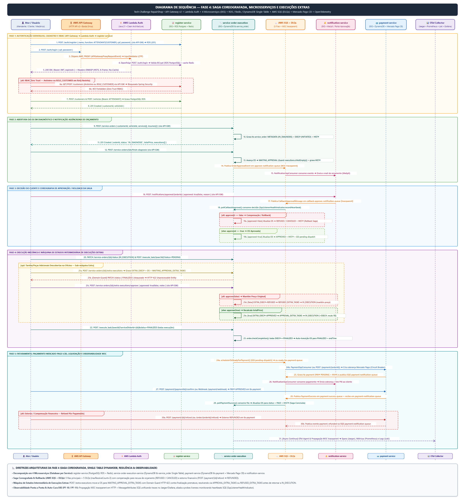
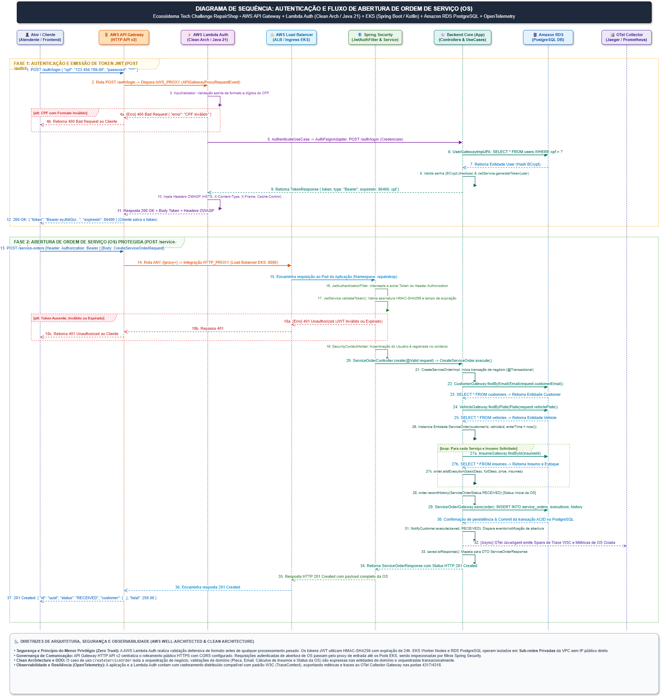

# 🔄 Diagramas de Sequência — Evolução Fase 3 ➔ Fase 4

Este diretório separa historicamente o diagrama de sequência desenvolvido na **Fase 3 (Arquitetura Monolítica + PostgreSQL)** do novo diagrama oficial da **Fase 4 (Microsserviços Distribuídos, Saga Coreografada com AWS SQS, DynamoDB Single-Table e Execuções Extras)**.

---

## 📁 Organização do Diretório

| Pasta | Fase | Escopo Arquitetural | Arquivos |
| :--- | :---: | :--- | :--- |
| **[`fase_3/`](fase_3/)** | **Fase 3** | Fluxo síncrono de autenticação (`Lambda Auth`) + abertura de OS no monólito (`Amazon RDS PostgreSQL`) | [diagrama_sequencia_auth_abertura_os.drawio](fase_3/diagrama_sequencia_auth_abertura_os.drawio) · [SVG](fase_3/diagrama_sequencia_auth_abertura_os.drawio.svg) · [PNG](fase_3/diagrama_sequencia_auth_abertura_os.drawio.png) |
| **[`fase_4/`](fase_4/)** | **Fase 4** | Fluxo completo da **Saga Coreografada** entre os **4 microsserviços**, **5 filas AWS SQS + DLQs**, **Máquina de Estados Intermediária de Execuções Extras**, **Mercado Pago (Circuit Breaker)**, **Rollbacks** e **W3C `traceparent`** | [diagrama_sequencia_saga_fase_4.drawio](fase_4/diagrama_sequencia_saga_fase_4.drawio) · [SVG](fase_4/diagrama_sequencia_saga_fase_4.drawio.svg) · [PNG](fase_4/diagrama_sequencia_saga_fase_4.drawio.png) |

---

## 📊 Comparativo Técnico: Fase 3 vs. Fase 4

| Dimensão | Fase 3 (`fase_3/`) | Fase 4 (`fase_4/`) |
| :--- | :--- | :--- |
| **Topologia de Aplicação** | Aplicação única (Monólito Modular no EKS) | **4 Microsserviços independentes** (`register-service`, `service-order-execution-service`, `payment-service`, `notification-service`) + `lambda-auth` |
| **Persistência** | Banco único PostgreSQL (`Amazon RDS`) com transação ACID local (`@Transactional`) | **Persistência Poliglota (Database per Service)**: PostgreSQL RDS + Redis (`register-service`), DynamoDB Single-Table `tb-service_order` (`service-order-execution-service`) e DynamoDB `tb-payment` (`payment-service`) |
| **Coordenação do Fluxo** | Chamadas locais e síncronas em memória dentro do mesmo processo | **Saga Pattern Coreografado** com 5 filas AWS SQS + 5 DLQs (`approve-notification-queue`, `callback-approve-notification-queue`, `os-ready-for-payment-queue`, `payment-notification-queue`, `payment-success-queue`) |
| **Fluxo Coberto no Diagrama** | Login (`POST /auth/login`) + Abertura de OS (`POST /service-orders`) | Ciclo completo: Autenticação/RBAC (`403`) ➔ Abertura OS (`IN_DIAGNOSIS`) ➔ Notificação/Aprovação (`WAITING_APPROVAL` / `REFUSED`) ➔ Execução & **Execuções Extras** (`WAITING_APPROVAL_EXTRA_TASKS`, `422` Guard, recálculo) ➔ Pagamento/Webhook/Estorno (`PAID` / `REFUNDED`) |
| **Observabilidade Distribuída** | Trace único dentro da API + RDS | Propagação W3C **`traceparent`** via headers HTTP e `MessageAttributes` SQS conectando traces ponta a ponta no **Jaeger / Prometheus / Loki / Grafana** |

---

## 1. Diagrama da Fase 4 (Atual — Saga Completa & Execuções Extras)

> 📄 Arquivos editáveis/vetoriais: [`diagrama_sequencia_saga_fase_4.drawio`](fase_4/diagrama_sequencia_saga_fase_4.drawio) | [`diagrama_sequencia_saga_fase_4.drawio.svg`](fase_4/diagrama_sequencia_saga_fase_4.drawio.svg)

---

## 2. Diagrama da Fase 3 (Histórico — Autenticação e Abertura de OS no Monólito)

> 📄 Arquivos editáveis/vetoriais: [`diagrama_sequencia_auth_abertura_os.drawio`](fase_3/diagrama_sequencia_auth_abertura_os.drawio) | [`diagrama_sequencia_auth_abertura_os.drawio.svg`](fase_3/diagrama_sequencia_auth_abertura_os.drawio.svg)
