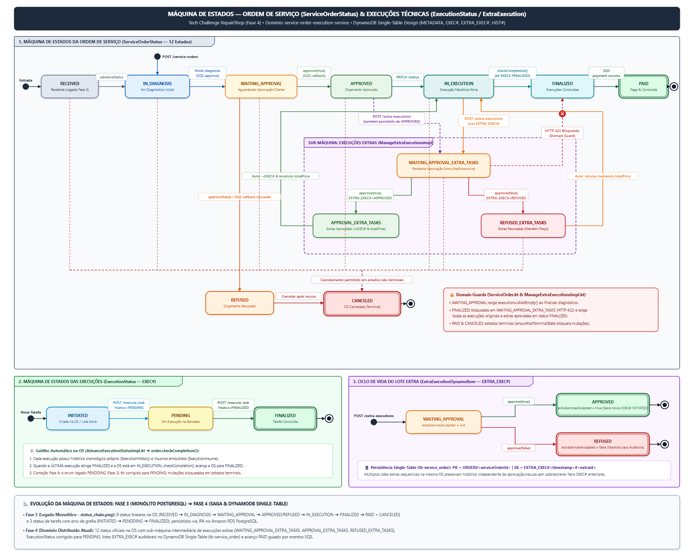
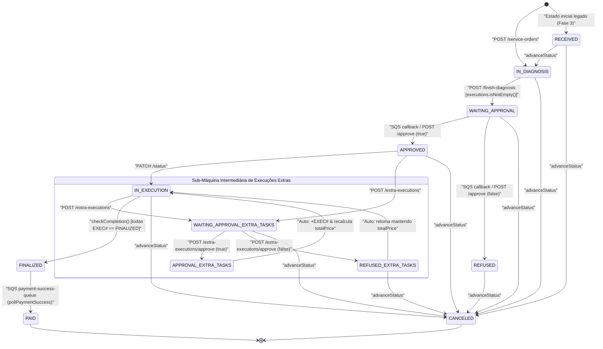
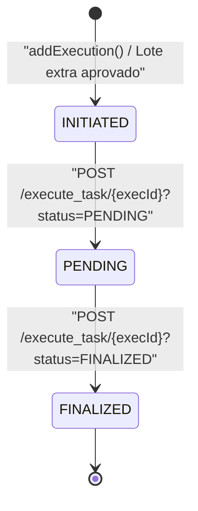
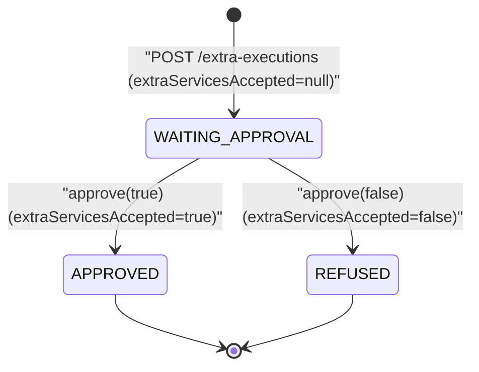

# 🔀 Máquinas de Estados — Ordem de Serviço (OS), Execuções e Execuções Extras

Este diretório documenta as máquinas de estado implementadas no domínio do microsserviço **`tech-challenge-repairshop-app-service-order-execution-service`** (Fase 4), persistidas sob **DynamoDB Single-Table Design** (`tb-service_order`) e auditadas cronologicamente por itens `HIST#`.

> 📄 Arquivos do diagrama:
> - **Editável (Draw.io):** [`diagrama_maquina_estados_os_e_execucoes.drawio`](diagrama_maquina_estados_os_e_execucoes.drawio)
> - **Vetorial (SVG):** [`diagrama_maquina_estados_os_e_execucoes.drawio.svg`](diagrama_maquina_estados_os_e_execucoes.drawio.svg)
> - **Imagem (PNG):** [`diagrama_maquina_estados_os_e_execucoes.drawio.png`](diagrama_maquina_estados_os_e_execucoes.drawio.png)

---

## 1. Máquina de Estados da Ordem de Serviço (`ServiceOrderStatus` — 12 Estados)

Definida em `ServiceOrderStatus.kt` e protegida pelas invariantes de domínio em `ServiceOrder.kt`:

### Tabela de Transições Permitidas (`ServiceOrderStatus.allowedTransitions()`)

| Estado Atual | Transições Permitidas | Gatilho / Endpoint / Evento | Domain Guards e Regras |
| :--- | :--- | :--- | :--- |
| **`RECEIVED`** | `IN_DIAGNOSIS`, `CANCELED` | `PATCH /service-orders/{id}/status` | Estado legado da Fase 3 mantido para compatibilidade |
| **`IN_DIAGNOSIS`** | `WAITING_APPROVAL`, `CANCELED` | `POST /service-orders/{id}/finish-diagnosis` | Para ir a `WAITING_APPROVAL`, exige `executions.isNotEmpty()` |
| **`WAITING_APPROVAL`** | `APPROVED`, `REFUSED`, `CANCELED` | `SQS callback-approve-notification-queue` / `POST /approve` | Publicação prévia de orçamento em `approve-notification-queue` |
| **`REFUSED`** | `CANCELED` | `PATCH /service-orders/{id}/status` | Fluxo de encerramento por recusa do orçamento inicial |
| **`APPROVED`** | `IN_EXECUTION`, `WAITING_APPROVAL_EXTRA_TASKS`, `CANCELED` | `PATCH /status` ou `POST /extra-executions` | Habilita início das tarefas ou inclusão prévia de lote extra |
| **`IN_EXECUTION`** | `WAITING_APPROVAL_EXTRA_TASKS`, `FINALIZED`, `CANCELED` | `POST /extra-executions` ou `order.checkCompletion()` | Para ir a `FINALIZED`, **todas** as execuções devem estar `FINALIZED` e define `endTime` |
| **`WAITING_APPROVAL_EXTRA_TASKS`** | `APPROVAL_EXTRA_TASKS`, `REFUSED_EXTRA_TASKS`, `CANCELED` | `POST /service-orders/{id}/extra-executions/approve` | **Bloqueio `HTTP 422`**: proibido avançar para `FINALIZED` enquanto pendente |
| **`APPROVAL_EXTRA_TASKS`** | `IN_EXECUTION` | Automático dentro de `ManageExtraExecutionsImpl` | Marca `EXTRA_EXEC# = APPROVED`, integra novas `EXEC#` e recalcula `totalPrice` |
| **`REFUSED_EXTRA_TASKS`** | `IN_EXECUTION`, `CANCELED` | Automático (`IN_EXECUTION`) ou `PATCH /status` | Marca `EXTRA_EXEC# = REFUSED` e mantém `totalPrice` anterior |
| **`FINALIZED`** | `PAID` | `SQS payment-success-queue` (`pollPaymentSuccess()`) | `ensureNotTerminalState` bloqueia novas execuções após `FINALIZED` |
| **`PAID`** *(Terminal)* | `∅` | — | Estado terminal; qualquer mutação lança `InvalidStateTransitionException` (`422`) |
| **`CANCELED`** *(Terminal)* | `∅` | — | Estado terminal; qualquer mutação lança `InvalidStateTransitionException` (`422`) |

---

## 2. Máquina de Estados das Execuções Técnicas (`ExecutionStatus` — `EXEC#`)

- **Gatilho de Conclusão (`AdvanceExecutionStatusImpl.kt`)**: Ao concluir uma execução (`FINALIZED`), o caso de uso invoca `order.checkCompletion()`. Quando `order.status == IN_EXECUTION` e todas as execuções vinculadas estão em `FINALIZED`, a OS avança automaticamente para `FINALIZED`.
- **Evolução Fase 3 ➔ Fase 4**: Corrige o typo legado `PENDDING` (presente em [status_chain.png](../infrastructure/status_chain.png)) para `PENDING`.

---

## 3. Ciclo de Vida do Lote de Execuções Extras (`ExtraExecutionDynamoItem` — `EXTRA_EXEC#`)

Persistido em `tb-service_order` com `PK = ORDER#<service_order_id>` e `SK = EXTRA_EXEC#<timestamp>#<extra_execution_id>`:

- **Rastreabilidade de Auditoria**: Tanto lotes `APPROVED` quanto lotes `REFUSED` permanecem armazenados em `tb-service_order` para trilha completa do orçamento, mesmo após o retorno da OS para `IN_EXECUTION`.
